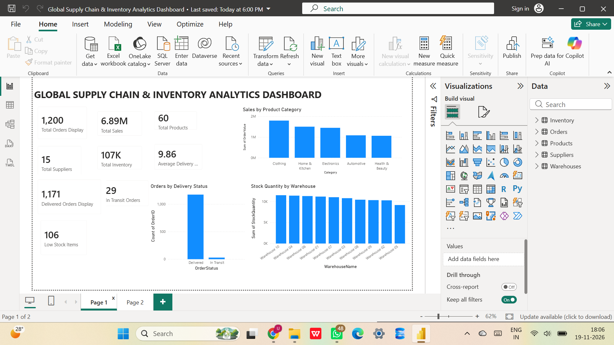
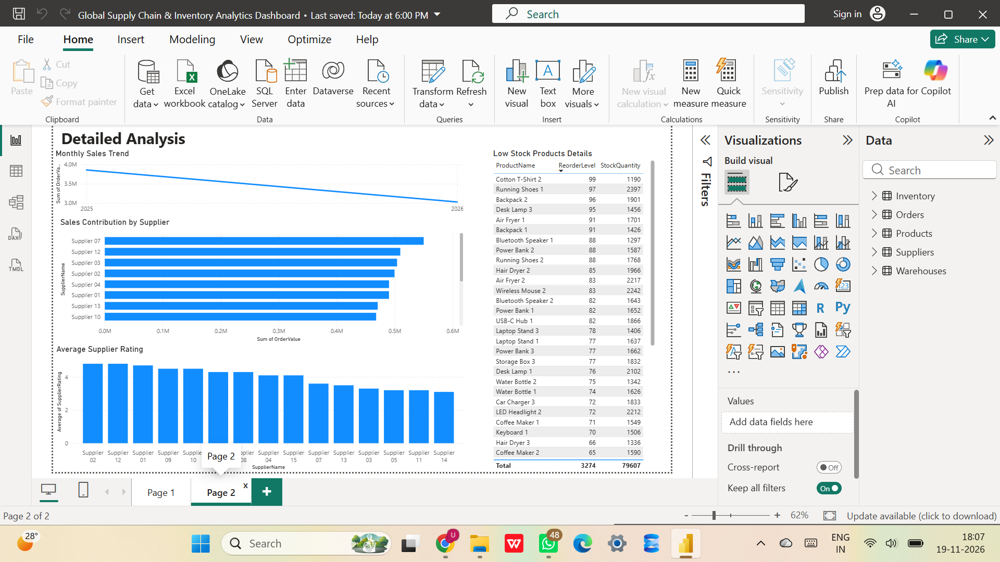

# Global Supply Chain & Inventory Analytics Dashboard

## Project Overview
This project is an interactive Power BI dashboard designed to analyze global supply chain operations, sales performance, inventory levels, supplier performance, and order delivery status.

The dashboard helps users monitor key business metrics, identify low-stock products, and understand inventory and sales trends.

## Tools & Technologies
- Power BI
- Power Query
- DAX
- Microsoft Excel

## Dataset Description
The project uses an Excel dataset containing five sheets:
- Orders
- Products
- Inventory
- Suppliers
- Warehouses

## Dashboard Pages

### Page 1 – Overview Dashboard
Provides a summary of key business performance indicators.

**Key KPIs:**
- Total Orders
- Total Sales
- Total Products
- Total Suppliers
- Total Inventory
- Average Delivery Days
- Delivered Orders
- In Transit Orders
- Low Stock Items

**Visualizations:**
- Sales by Product Category
- Stock Quantity by Warehouse
- Orders by Delivery Status

### Page 2 – Detailed Analysis
Provides detailed insights into sales, suppliers, and inventory.

**Visualizations:**
- Monthly Sales Trend
- Sales Contribution by Supplier
- Average Supplier Rating
- Low Stock Products Details

## Dashboard Screenshots

### Page 1 – Overview Dashboard

### Page 2 – Detailed Analysis

## Key Learnings
- Data cleaning and transformation using Power Query.
- Creating KPIs and measures in Power BI.
- Designing interactive dashboards.
- Analyzing sales and inventory performance.
- Identifying low-stock products and supplier trends.

## Project Files
- Power BI Dashboard (.pbix)
- Excel Dataset (.xlsx)
- Dashboard Screenshots (.png)

## Conclusion
This project demonstrates how Power BI can be used to transform supply chain data into meaningful business insights and support data-driven decision-making.
